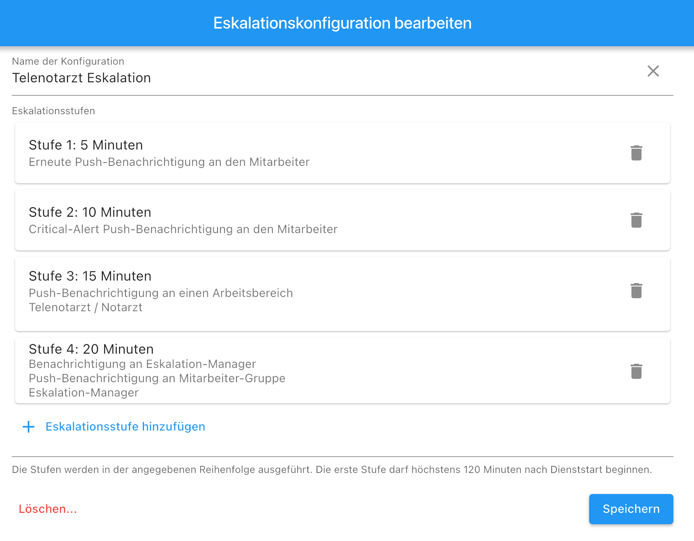
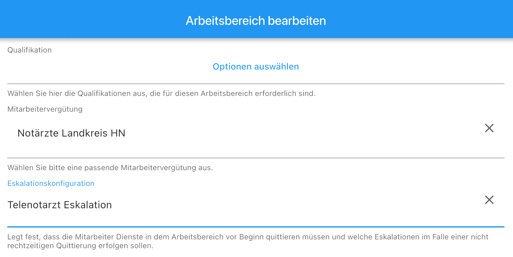
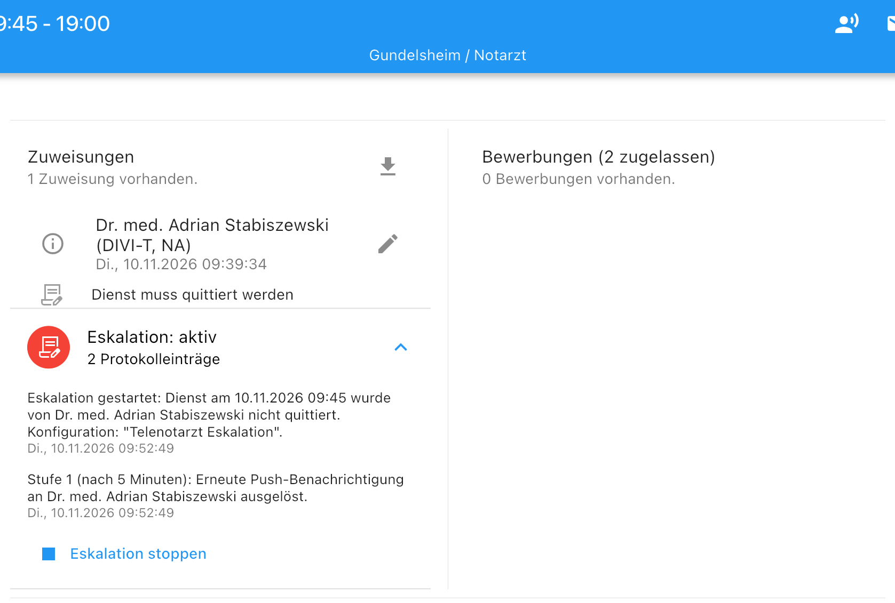
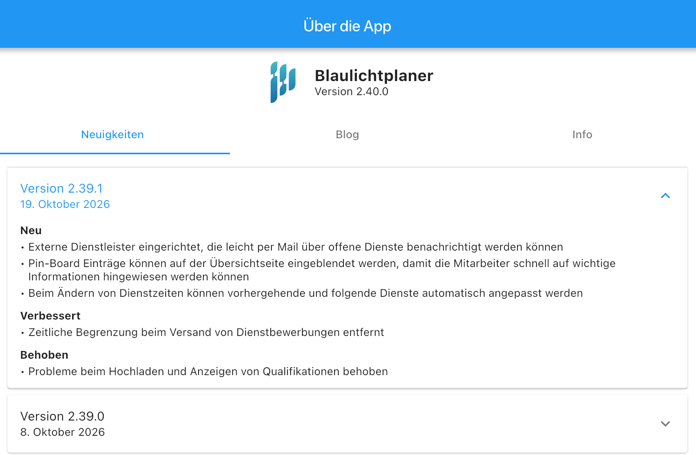
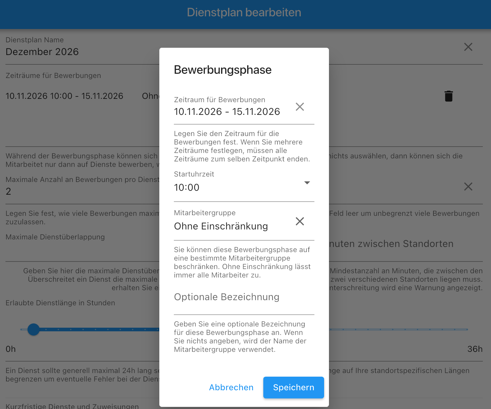
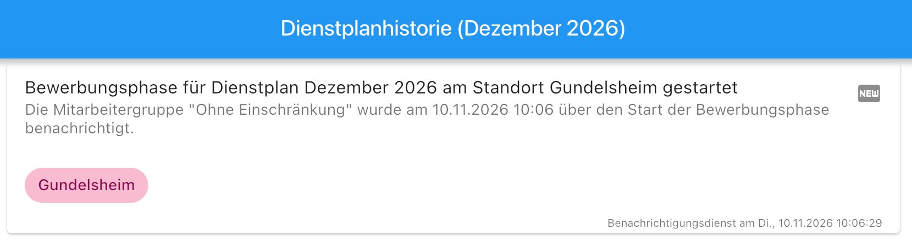

In diesem Update stellen wir Ihnen die neuen Funktionen und Verbesserungen der Version 2.39.2 vor. In erster Linie wurden mit dem Update die Eskalationsstufen für die Dienstquittierung eingeführt. Damit können fehlende Quittierungen schneller erkannt und entsprechende Maßnahmen ergriffen werden. 
Darüber hinaus können Sie jetzt den Start einer Bewerbungsphase stundengenau festlegen. Die Mitarbeiter werden dann auch unmittelbar über den Start der Bewerbungsphase informiert.

Damit Sie zukünftig leichter auf diesen Blog zugreifen und die neuesten Informationen erhalten können, haben wir den Bereich "Über die App" mit Neuigkeiten und Blog-Beiträgen überarbeitet.

### Eskalationen für unbestätigte Dienste eingerichtet

Wir haben bereits vor ein paar Wochen die Möglichkeit eingeführt, dass Mitarbeiter den Start eines Dienstes bestätigen müssen. Nun haben wir zusätzlich Eskalationen für unbestätigte Dienste eingerichtet. Damit können Sie schnell in Erfahrung bringen, ob ein Mitarbeiter einen Dienst vergessen hat.

Um die Eskalation einzurichten gehen Sie in die Firmen-Verwaltung und wählen dort den Menüpunkt "Eskalationskonfigurationen" aus. Sie können dort je nach Bedarf mehrere Eskalationen anlegen und konfigurieren. Jede Eskalation kann individuell festlegen, nach welcher Zeitspanne und an wen eine Benachrichtigung gesendet werden soll, wenn ein Dienst nicht bestätigt wurde.
Sie können zwischen folgenden Eskalationsarten wählen:
- Erneute Benachrichtigung an den Mitarbeiter, wenn ein Dienst nicht bestätigt wurde.
- Benachrichtigung an eine Person in einem altenativen Dienstplan (via Arbeitsbereich)
- Benachrichtigung an einen Personenkreis, der via eine Mitarbeitergruppe definiert ist.
- Critical-Alert (bei stummgeschalteten Smartphones) an einen definierten Personenkreis (in Planung).

Nachdem Sie eine Eskalation eingerichtet haben, können Sie dann im Arbeitsbereich die Konfiguration auswählen und somit die Dienstquittierung als auch die Eskalation aktivieren.
Bitte beachten Sie, dass die Konfiguration erst für alle Zuweisungen gilt, die danach erstellt werden. Bereits bestehende Zuweisungen sind von der neuen Eskalationskonfiguration nicht betroffen.

Sobald Sie eine neue Zuweisung erstellen wird unter dem Mitarbeiter angezeigt, dass der Dienst quittiert werden muss. Damit können Sie sehen, dass die Quittierung und Eskalation korrekt eingerichtet sind.

Sollte der Mitarbeiter den Dienst nicht quittieren beginnt dann die Eskalation gemäß der zuvor eingerichteten Eskalationskonfiguration. In der Zuweisungsmaske können Sie den aktuellen Status der Quittierung und Eskalation einsehen. Jeder Schritt wird dokumentiert und die entsprechenden Benachrichtigungen werden angezeigt.

Die Eskalation endet automatisch, sobald der Mitarbeiter den Dienst quittiert hat, dieser von dem Dienstabgelöst wurde oder alle Stufen der Eskalationskonfiguration durchlaufen wurden.
Sie haben auch die Möglichkeit, die Eskalation manuell jederzeit zu stoppen. Danach werden keine weiteren Benachrichtigungen mehr gesendet. Die Zuweisung bleibt jedoch bestehen.

### Über die App Bereich mit Neuigkeiten und Blog überarbeitet

In dem Menüpunkt "Über die App" finden Sie nun einen Bereich mit Neuigkeiten und Blog-Beiträgen. Hier werden aktuelle Informationen, Tipps und Ankündigungen rund um den Blaulichtplaner bereitgestellt. So bleiben Sie immer auf dem neuesten Stand und verpassen keine wichtigen Updates mehr.
Sobald es eine neue App Version gibt, sehen Sie an dem Menüpunkt einen roten Punkt. Daraufhin könne Sie dann alle Neuerungen und Änderung an der App sehen. In unregelmäßigen Abständen werden hier auch Blog-Beiträge veröffentlicht, die zusätzliche Informationen und Tipps rund um den Blaulichtplaner enthalten.

### Stundengenauer Bewerbungsstart

Der Bewerbungsstart kann jetzt stundengenau definiert werden. Sie können dies in den Standorteinstellungen als Vorlage anlegen oder direkt
beim Erstellen eines neuen Dienstplans festlegen. Der bisherige feste Bewerbungsstart um Mitternacht lässt sich somit jetzt individuell
einstellen. Die Benachrichtigung der Mitarbeiter erfolgt dann entsprechend zum definierten Bewerbungsstart und nicht mehr fest um 8:30 Uhr.

Gleichzeitig können Sie jetzt im Dienstplanprotokoll sehen, wann und welche Gruppe von Mitarbeitern über den Bewerbungsstart benachrichtigt worden ist.

### Weitere Änderungen

- Der Download und Export von Daten wurde jetzt vereinheitlicht.
- Probleme beim Export der Dienstplanstatistiken behoben

Zögern Sie bitte nicht unser Team unter <a href="mailto:info@blaulichtplaner.de">info@blaulichtplaner.de</a> zu kontaktieren um Ihre Wünsche und Anregungen zu äußern. Wir entwickeln den Blaulichtplaner immer in Zusammenarbeit mit unseren Kunden und Partnern weiter.
